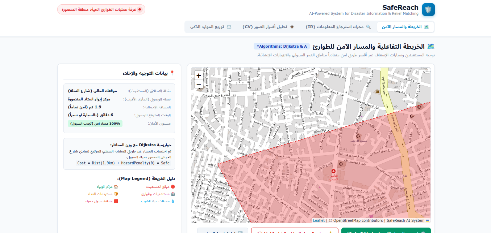
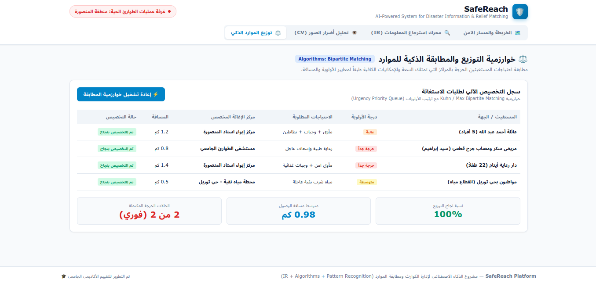
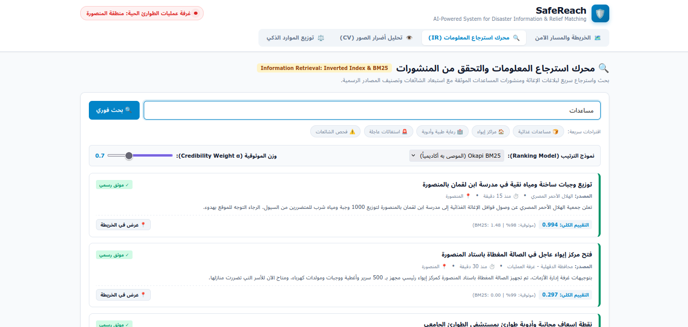
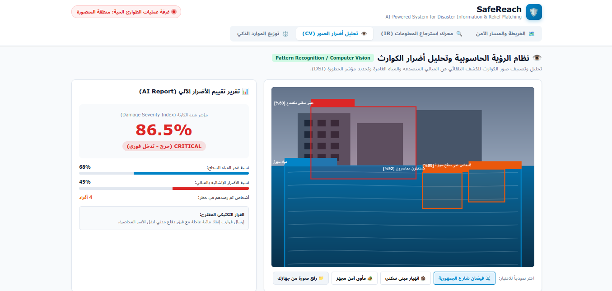

# SafeReach 
### AI-Powered System for Real-Time Disaster Information and Relief Resource Matching

> **"The right information ... to the right people ... at the right time"**  
> مشروع أكاديمي متكامل يجمع بين مواد: **Information Retrieval (IR)** + **Design & Analysis of Algorithms** + **Pattern Recognition / Computer Vision**.

---

## Project Preview
---
<p align="center">
  
  
</p><p align="center">
  
  
</p><p align="center">
  <em>SafeReach — AI-Powered Disaster Information & Relief Dashboard</em>
</p>

---

##  فكرة المشروع ومكوناته (Project Overview)

أثناء الكوارث الطبيعية (السيول، الفيضانات، الزلازل)، يواجه المتضررون وفرق الإنقاذ 4 مشاكل رئيسية:
1. **انتشار الشائعات والأخبار المضللة على السوشيال ميديا.**
2. **صعوبة وبطء الوصول إلى الإغاثة والملاجئ بسبب الطرق المغمورة بالسيول.**
3. **عدم توزيع المساعدات بشكل عادل وفعال طبقاً لدرجة الخطورة.**
4. **صعوبة تقييم الأضرار في المناطق المنكوبة فور حدوثها.**

نظام **SafeReach** يقدم حلاً تكنولوجياً متكاملاً عبر 3 محاور علمية:

| المحور الأكاديمي | اسم الموديول | الوظيفة والخوارزمية المطبقة |
| :--- | :--- | :--- |
| **Information Retrieval (IR)** | `core/ir_engine.py` | محرك بحث واسترجاع للنصوص العربية والإنجليزية عبر **Inverted Index** و **Okapi BM25** مع فلتر تحقق من الشائعات (**Credibility Scoring**). |
| **Algorithms** | `core/algorithms_module.py` | حساب المسارات الآمنة وتفادي السيول بخوارزمية **Dijkstra و A\*** (مع أوزان أخطار حركية)، وتوزيع الموارد بخوارزمية **Maximum Bipartite Matching**. |
| **Pattern Recognition / CV** | `core/vision_module.py` | تحليل صور الكوارث بكشف الأجسام (**Object Detection / YOLO format**) وحساب مؤشر شدة الكارثة (**Damage Severity Index - DSI**). |

---

##  هيكل مجلدات المشروع (Directory Structure)

```text
SafeReach/
│
├── run_safereach.bat         # ملف تشغيل الموقع بضغطة زر واحدة في المتصفح
├── README.md                 # دليل المشروع وطريقة التشغيل
│
├── web/                      # الواجهة التفاعلية الكاملة للمشروع (Web Application)
│   ├── index.html            # الصفحة الرئيسية ولوحة التحكم
│   ├── app.js                # منطق الربط والخريطة ومحرك الـ IR والـ CV
│   └── styles.css            # التصميم وتنسيقات منصة الطوارئ
│
├── core/                     # أكواد المواد الأكاديمية (Python Core)
│   ├── ir_engine.py          # [IR] Inverted Index + BM25 + TF-IDF + Credibility
│   ├── algorithms_module.py  # [Algorithms] Dijkstra Hazard Detour + Bipartite Matching
│   └── vision_module.py      # [Pattern/CV] Damage Detection + Severity Calculator
│
└── data/                     # البيانات والشبكات الجغرافية
    └── disaster_data.json    # داتا سيت المنشورات، شبكة الطرق، مراكز الإغاثة، المستغيثين
```

---

##  كيفية تشغيل المشروع (How to Run)

### 1. تشغيل موقع الويب التفاعلي (SafeReach Web Dashboard):
* ببساطة، اضغط دبل كليك على الملف: **`run_safereach.bat`**  
* أو افتح الملف **`web/index.html`** مباشرة في أي متصفح (Chrome, Edge, Firefox).
* سيعمل الموقع كاملاً بدون الحاجة لأي تثبيت أو سيرفرات معقدة!

### 2. تشغيل واختبار أكواد ال Python :
```bash
# اختبار موديول استرجاع المعلومات (IR)
python core/ir_engine.py

# اختبار موديول الخوارزميات وتفادي الطرق المغمورة وتوزيع الموارد
python core/algorithms_module.py

# اختبار موديول الرؤية الحاسوبية وتحديد شدة الضرر من الصور
python core/vision_module.py
```
---


##  مميزات المشروع أمام لجنة التحكيم:
* يغطي مشكلة واقعية تخدم أهداف التنمية المجتمعية والإنسانية.
* يجمع 3 مناهج في تطبيق واحد حي وشغال.
* واجهة مستخدم احترافية بالكامل بالخريطة الحية ومحرك البحث وأداة فحص الصور.

---

<div align="center">

**Built with teamwork by OCTAVE 🎀**

*One team. One vision. A safer tomorrow.*

<sub>Hagar Mahmoud Ahmed · Rana Hany Ali · Eman Abdelrahman Mohamed · Alaa Salah Bakr</sub>

<sub>Shahd Alhindawy · Zainab Talaat Antar · Shahd Atef Hendy · Thuraya Samy Abdelati</sub>

</div>
